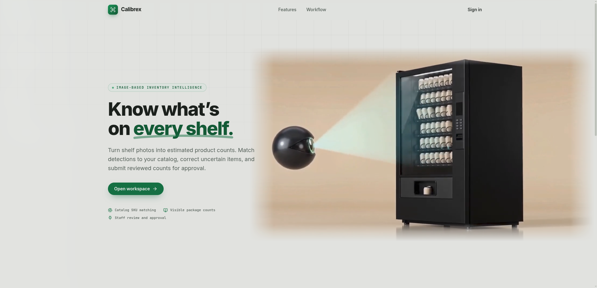
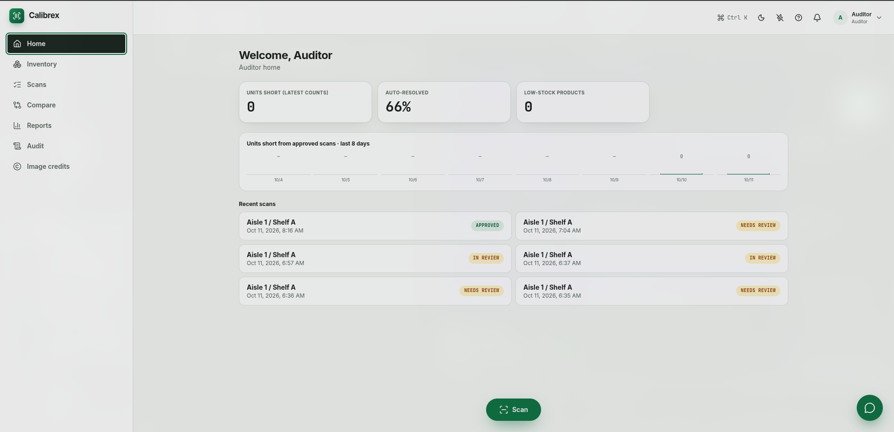

# Calibrex

<div align="center">
  <p><strong>Image-based inventory intelligence for retail shelves</strong><br>
  Turn shelf photos into package-count estimates, match detections to your catalog, and review every count before approval.</p>
  <p>
    <a href="#features">Features</a> ·
    <a href="#workflow">Workflow</a> ·
    <a href="#setup">Setup</a> ·
    <a href="#stack">Stack</a>
  </p>
</div>

<p align="center">
  
  
</p>

> **Human review stays in the loop:** Calibrex counts visible package detections. Staff review and correct estimates before a manager approves a scan.

## At a glance

| Area | Details |
| --- | --- |
| Product | Shelf-image inventory counting and variance review |
| Detection | Fine-tuned Calibrex YOLO checkpoint |
| Catalog matching | DINOv2 image embeddings with Qdrant search |
| Workflow | Staff review, manager approval, reports, and audit history |
| Stack | React + TypeScript · FastAPI · PostgreSQL · Qdrant |

## Features

- Detect visible packages in shelf photos and estimate quantities by matched SKU.
- Keep unmatched detections under **Unknown** until staff resolves them.
- Review scans, compare counts with expected stock, and approve submitted counts.
- Use live camera detection where browser permissions and a secure origin are available.
- Track scan decisions and inventory changes through reports and the audit trail.
- Ask CaliBot questions about the workspace catalog, on-hand counts, low stock, and inventory coverage.

## Workflow

1. Add products and reference photos to the catalog.
2. Capture or upload a shelf image. The detector finds package boxes; catalog photos help match boxes to SKUs.
3. Staff review detections, correct uncertain matches, and submit the count.
4. A manager approves or returns the scan. Approved counts update inventory variance and reports.

Catalog photos improve SKU matching; they do not retrain the detector. See the [catalog setup and import guide](docs/catalog-import.md).

## Setup

### Run with Docker Compose

The standard stack starts the web app, API, PostgreSQL, Qdrant, and the real CPU inference worker:

```bash
docker compose up --build
```

Open [http://localhost:8080](http://localhost:8080) and create an account with your name, email, and password. The creator becomes Owner of a new, empty supermarket workspace. Owners invite Managers, Staff, and Auditors from **Team & settings**; invited members share that supermarket's catalog, shelves, scans, and inventory according to their role. Existing non-Owner accounts can join another supermarket by accepting its invite and confirming their current password. The default setup does not seed demo users or catalog data. Add products and reference photos in **Catalog** before scanning to enable automatic SKU matching. The first worker startup downloads DINOv2 weights.

### CaliBot inventory assistant

CaliBot appears as a chat button at the bottom-right of the workspace. It opens as a popup and can expand to a centered, larger panel. It is available to every workspace role and can answer questions about catalog products, on-hand counts, low-stock alerts, products with the highest counts, and count coverage. CaliBot is read-only; use the Catalog, Inventory, and Reports pages to make changes or review the full records.

To enable CaliBot, add your GroqCloud key to the project-root `.env` file:

```dotenv
GROQ_API_KEY=your_groq_api_key
# Optional; defaults to openai/gpt-oss-120b
GROQ_MODEL=openai/gpt-oss-120b
```

Then build/recreate the API and web containers so Compose passes the key to the backend and publishes the frontend:

```bash
docker compose up -d --build api proxy
```

The key stays in the API container and is never sent to the browser. For each question, the backend supplies the active workspace’s catalog and inventory summary to Groq. On-hand quantities come from each shelf’s latest approved scan; expected quantities are configured values, not a live warehouse feed. Uncounted shelves and partial coverage are identified as such. Groq receives the workspace context and recent chat turns to generate its answer. Chat history is kept in the current browser session and is not saved as a Calibrex record. If `GROQ_API_KEY` is unset or the configured model is unavailable, the chat reports a setup/service error.

The worker loads the fine-tuned checkpoint at `ai-worker/runs/detect/runs/detect/calibrex_s960/weights/best.pt`. Docker copies it into the worker image; a missing or invalid checkpoint causes startup to fail clearly. The optional H5 model is excluded from GitHub because of its size. To use it locally, place `iou_resnet50_csv_06.h5` in the project root and start with the H5 overlay:

```bash
docker compose -f docker-compose.yml -f docker-compose.h5.yml up --build
```

### Production

Copy `.env.production.example` to `.env.production`, set deployment secrets and public URLs, then start the production overlay:

```bash
docker compose --env-file .env.production \
  -f docker-compose.yml -f docker-compose.production.yml up -d --build
```

Keep production secrets out of source control. See [backup and restore](ops/restore-local.md) for local data recovery guidance.

## Stack

| Component | Role |
| --- | --- |
| React, TypeScript, Vite | Web application |
| FastAPI, SQLAlchemy, Alembic | Authenticated API and database migrations |
| PostgreSQL | Organizations, catalog, scans, inventory, and audit data |
| Calibrex YOLO | Visible package detection |
| DINOv2 and Qdrant | Product-reference image matching |

## Guides

- [Catalog setup and Open Food Facts imports](docs/catalog-import.md)
- [AI worker configuration and evaluation](ai-worker/README.md)
- [Model training](docs/TRAINING.md)
- [Local test guide](TEST_GUIDE.md)
- [Backup and restore](ops/restore-local.md)
